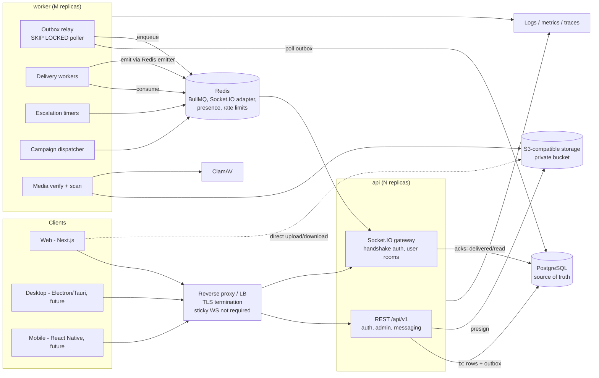

# Storeline — Architecture Proposal

Storeline is a multi-tenant business messaging and store-operations platform. It offers
a familiar chat experience (one-to-one, groups, receipts, reactions, media) plus
enterprise administration (businesses → stores → users), privacy-protected emergency
contacts, and controlled bulk messaging.

This document is the entry point. Detailed designs:

| Topic | Document |
| --- | --- |
| Data model, ER diagram, retention semantics | [data-model.md](data-model.md) |
| Multi-tenant authorization, role/permission matrix | [authorization.md](authorization.md) |
| Message pipeline, state model, WebSocket contract, recovery | [messaging.md](messaging.md) |
| Secure media upload / download | [media.md](media.md) |
| Emergency contact privacy and escalation | [emergency.md](emergency.md) |
| Threat model | [../security/threat-model.md](../security/threat-model.md) |
| API outline | [../api/outline.md](../api/outline.md) |
| Performance and load-testing plan | [../operations/performance-plan.md](../operations/performance-plan.md) |
| Phased checklist and open product decisions | [../roadmap.md](../roadmap.md) |
| Architecture decision records | [../adr/](../adr/) |

## 1. Architecture in one paragraph

A **modular monolith** written in TypeScript (NestJS) is deployed as two process types
built from one codebase: **`api`** (REST `/api/v1` + Socket.IO gateway) and **`worker`**
(outbox relay, delivery fan-out, escalation timers, campaign dispatch, media scanning).
PostgreSQL is the single source of truth. Every state change that must reach other users
is written **in the same transaction** as an `OutboxEvent`; the worker relays outbox
events into BullMQ (Redis), and delivery workers push them to connected devices through
the Socket.IO Redis adapter/emitter. Clients acknowledge delivery and reads, which are
persisted as per-member watermarks. Media never passes through WebSockets or the API
process: clients upload directly to private S3-compatible storage with short-lived,
size-bounded presigned URLs, and files are only released to recipients after
verification and malware scanning. The Next.js web client, and future Electron/Tauri
and React Native clients, share one API contract and the `@storeline/shared` package
(Zod schemas, domain types, permission catalog).

## 2. System architecture diagram



## 3. Module and repository breakdown

```
apps/
  api/                    NestJS modular monolith; two entrypoints
    src/main.ts           HTTP + WebSocket process
    src/worker.ts         background worker process
    src/infra/            config, prisma, redis, queues, logging, crypto
    src/modules/
      auth/               login, refresh rotation, sessions, MFA (TOTP)
      authorization/      permission evaluation, guards, scope resolution
      audit/              append-only audit log
      businesses/ stores/ users/ roles/
      conversations/      direct + group conversations, membership
      messages/           send/edit/delete/react/forward/search, receipts
      realtime/           Socket.IO gateway, presence, typing, emitter
      outbox/             transactional outbox + relay + delivery processors
      emergency/          contacts, incidents, escalation          (phase 5)
      media/              upload sessions, verification, signed downloads
      campaigns/          bulk messaging                           (phase 6)
      devices/            devices, notification prefs, Web Push    (phase 8)
      health/             liveness / readiness
    prisma/               schema, migrations, seed
    test/                 integration + e2e (real Postgres/Redis)
  web/                    Next.js (App Router) client
packages/
  shared/                 Zod schemas, DTO types, permission catalog,
                          pure authorization evaluator, event contracts
infrastructure/
  docker/                 compose for local dev, Dockerfiles
docs/                     architecture, security, operations, ADRs
.github/workflows/        CI: lint, typecheck, unit + integration tests, audit
```

Module rules:

- Modules talk through exported services, never through each other's Prisma models
  directly (enforced by review; lint rule planned).
- `@storeline/shared` has **no** runtime dependency on Node or the browser, so it can be
  reused unchanged by web, desktop, and mobile clients.
- The worker imports the same modules; it does not open HTTP ports except `/healthz`
  metrics.

## 4. Key decisions (see ADRs)

1. [ADR-0001](../adr/0001-modular-monolith.md) Modular monolith + separate worker process.
2. [ADR-0002](../adr/0002-transactional-outbox.md) Transactional outbox; WebSocket is a
   transport, not a delivery guarantee.
3. [ADR-0003](../adr/0003-per-conversation-sequence-and-watermarks.md) Per-conversation
   gap-free sequence numbers and per-member delivered/read watermarks.
4. [ADR-0004](../adr/0004-user-rooms-only.md) Server-resolved user rooms instead of
   client-joined conversation rooms.
5. [ADR-0005](../adr/0005-dependency-baseline.md) Dependency baseline and version policy.
6. [ADR-0006](../adr/0006-private-contact-table.md) Private contact data in a separate
   table, never selected by default.
7. [ADR-0007](../adr/0007-encryption-scope.md) Encryption scope: TLS + at-rest, not E2EE.
8. [ADR-0008](../adr/0008-media-storage-and-verification.md) Media storage layout and verify-then-promote pipeline.
