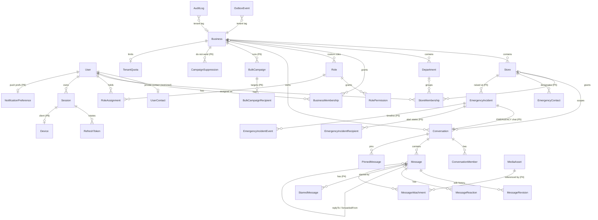

# Data Model

PostgreSQL is the source of truth. Prisma manages the schema and migrations
(`apps/api/prisma`). All identifiers are UUIDv4 (`gen_random_uuid()`), all timestamps
are `timestamptz` (`@db.Timestamptz(3)`), and every business-owned row carries a
`businessId` so tenant ownership can be checked without trusting the client.

## ER diagram (implemented + planned)

Entities marked *(P4/P5/P6)* are introduced in the corresponding phase.

## Core tables

| Table | Purpose | Key constraints / indexes |
| --- | --- | --- |
| `User` | Identity. `username` (normalized lowercase) and UUID `id`; **no** email/phone here. | `username` unique; `status` |
| `UserContact` | Private email/phone + verification timestamps. Only read by explicitly authorized flows (recovery, emergency notification channels, admin with `user.contact.read`). | PK `userId`; `email` unique |
| `Business` | Tenant root: slug, name, status, timezone, locale, settings JSON (policy). | `slug` unique |
| `Store` | Branch/store under a business. | (`businessId`,`code`) unique |
| `Department` | Optional team grouping under business/store. | (`businessId`,`storeId`,`name`) unique |
| `BusinessMembership` | User ↔ business with status. | (`businessId`,`userId`) unique |
| `StoreMembership` | User ↔ store (explicit; never implied by business membership). | (`storeId`,`userId`) unique; index `userId` |
| `Role` / `RolePermission` | System roles (`businessId` null) and per-business custom roles; permission keys from the shared catalog. | (`businessId`,`key`) unique + partial unique on `key` where `businessId is null` |
| `RoleAssignment` | User holds role at a scope: `PLATFORM`, `BUSINESS(businessId)`, `STORE(businessId, storeId)`. Soft-revoked. | index (`userId`,`revokedAt`) ; check constraint on scope columns |
| `Session` / `RefreshToken` | Server-side session (revocable) and rotating refresh tokens (hashed). Reuse of a consumed token revokes the session. | `tokenHash` unique |
| `Conversation` | DIRECT / GROUP / EMERGENCY. `lastSeq` is the per-conversation message counter. `directKey` dedupes DMs. | `directKey` unique; index (`businessId`) |
| `ConversationMember` | Membership + per-member state: `role`, `historyFromSeq`, `lastDeliveredSeq`, `lastReadSeq`, `mutedUntil`, `pinnedAt`, `archivedAt`, `leftAt`. | (`conversationId`,`userId`) unique; index (`userId`,`leftAt`) |
| `Message` | Immutable envelope + mutable body (edit/delete). `seq` gap-free per conversation. `clientMessageId` for idempotency. `state` = sender-side pipeline state. | (`conversationId`,`seq`) unique; (`senderId`,`clientMessageId`) unique; GIN FTS index on `body` |
| `MessageRevision` | Previous body on edit/delete (retention-governed). | index `messageId` |
| `MessageReaction` | One reaction per user per message. | PK (`messageId`,`userId`) |
| `PinnedMessage` / `StarredMessage` | Conversation pins; per-user stars. | composite PKs |
| `OutboxEvent` | Transactional outbox. | index (`status`,`availableAt`) |
| `AuditLog` | Append-only audit trail; no message bodies, no secrets. | index (`businessId`,`occurredAt`), (`actorUserId`,`occurredAt`) |
| `TenantQuota` | Per-business limits (max users, storage bytes, msgs/min, campaign size). | PK `businessId` |
| `EmergencyContact` | Ordered emergency contacts per store (pointer to a user; no contact values). Response time is `Store.emergencyAckTimeoutSeconds`. | (`storeId`,`userId`) and (`storeId`,`priority`) unique; priority 1–10 check |
| `EmergencyIncident` | Emergency alert: status, escalation level, deadline, outcome. | (`reporterId`,`clientIncidentId`) unique; partial unique (`reporterId`,`storeId`) while active; partial index on due deadlines |
| `EmergencyIncidentRecipient` | Escalation chain snapshot + per-recipient notification state and timestamps. | (`incidentId`,`userId`) unique |
| `EmergencyIncidentEvent` | Append-only incident timeline. | index (`incidentId`,`seq`) |
| `BulkCampaign` | Campaign content, audience JSON, state-machine timestamps, totals. | (`createdById`,`clientCampaignId`) unique; partial index on SENDING |
| `BulkCampaignRecipient` | Per-recipient pipeline state and the message written. | PK (`campaignId`,`userId`); `messageId` unique |
| `CampaignSuppression` | Do-not-send list per business (admin or self opt-out). | PK (`businessId`,`userId`) |
| `Conversation` (BROADCAST) | One read-only Announcements channel per recipient and business. | `channelKey` unique; CHECK type ↔ key |
| `Device` | Client bound 1:1 to a session; encrypted push token. | `sessionId` unique; `pushTokenHash` unique |
| `NotificationPreference` | Push on/off and lock-screen preview level. | PK `userId` |

## Per-recipient state: watermarks, not N rows per message

For ordinary conversation messages, per-recipient delivery and read state is stored as
**watermarks** on `ConversationMember` (`lastDeliveredSeq`, `lastReadSeq`). Because
`seq` is gap-free and ordered per conversation, "recipient R has received message M"
is exactly `R.lastDeliveredSeq >= M.seq`. This is O(1) writes per acknowledgement
instead of O(group size) rows per message, which matters for 30k+ msgs/day with large
groups. Per-message, per-recipient rows (`BulkCampaignRecipient`,
`EmergencyIncidentRecipient`) are used where individual attempts and failure reasons must
be reported.

## Retention and deletion semantics

| Data | Default behaviour | Notes |
| --- | --- | --- |
| Users | Never hard-deleted. `DEACTIVATED` revokes sessions and role assignments; profile remains for message attribution. | GDPR erasure requires a documented anonymisation job (open decision D7). |
| Businesses / stores | `ARCHIVED` / `SUSPENDED` only. Suspended business ⇒ all non-platform access denied. | |
| Messages — edit | Sender only, within `messageEditWindowMinutes` (default 15). Previous body stored in `MessageRevision`. Recipients see an "edited" label. | |
| Messages — delete for everyone | Sender within `messageDeleteWindowMinutes` (default 60) or a holder of `message.delete` (moderation). Body replaced by tombstone for all readers; original kept in `MessageRevision` for `deletedMessageRetentionDays` (default 30, configurable per business; legal hold overrides). | Purge job is phase 7. |
| Conversation membership | Removed/left members lose access to the conversation entirely (history, media, events). Rejoining starts at the current `lastSeq` (no backfill). | Safest default; see decision D3. |
| Media (P4) | Private bucket, signed URLs ≤ 5 min. Deleting a message removes access to its attachments; objects are purged by lifecycle after retention. | Already-downloaded copies cannot be recalled — documented limitation. |
| Audit log | Append-only; retained ≥ 400 days by default. Not editable through the API. | |
| Outbox events | Deleted 7 days after publication. | |

## Row-level security

Application-level authorization is the primary control. PostgreSQL RLS as defence in
depth is evaluated in decision D9: it requires a per-request `SET app.business_id` on a
pooled connection inside a transaction, which Prisma supports via interactive
transactions but at a throughput cost. Recommended: enable RLS on `Message`,
`Conversation`, `ConversationMember` in phase 7 after load tests quantify the cost.
