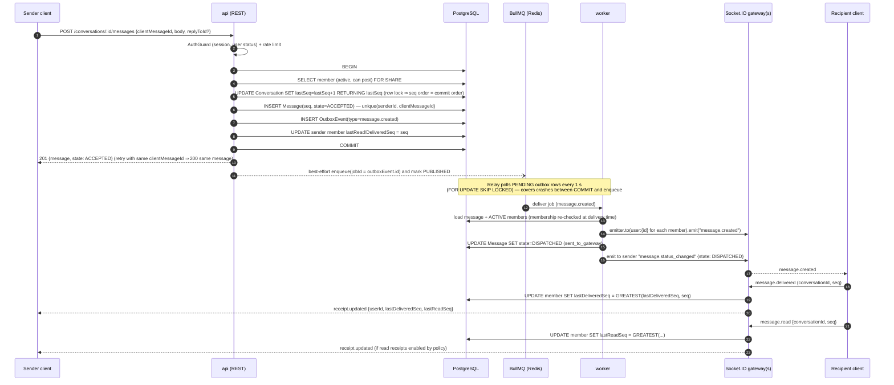
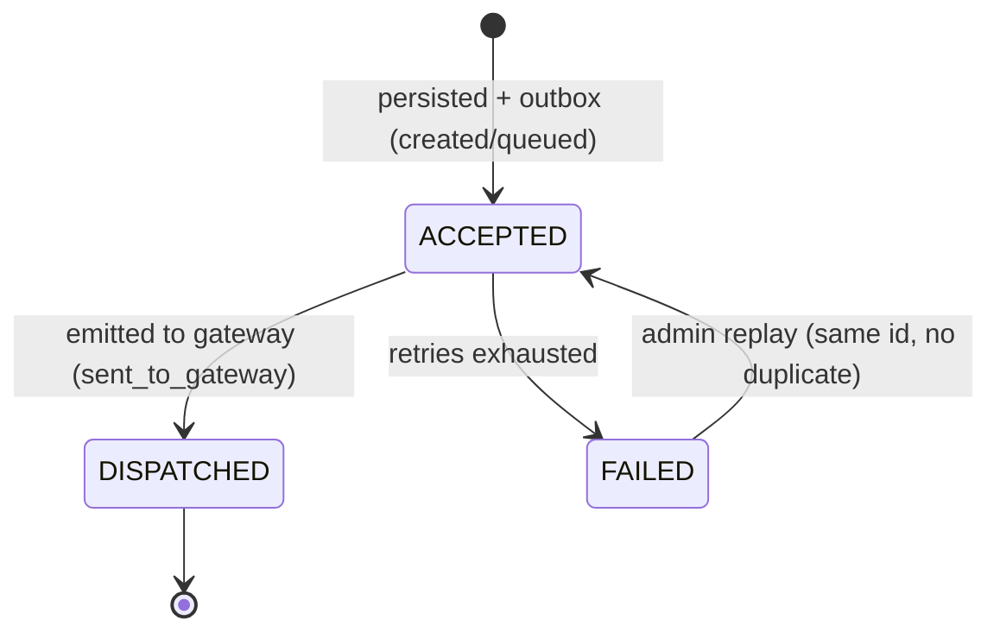

# Messaging Pipeline and Real-Time Architecture

## Guarantees (and non-guarantees)

- A `201 Created` from `POST /conversations/:id/messages` means the message **and** its
  delivery event are durably committed in PostgreSQL. It does **not** mean any recipient
  has it.
- Delivery to devices is **at-least-once**; clients de-duplicate by message `id`.
- Ordering is **total per conversation** (`seq`), not global.
- A successful Socket.IO emit is not proof of receipt. "Delivered" is recorded only
  when the recipient device acknowledges; "read" only when the client reports it.
- Missed events are always recoverable from the database (`seq` gap detection), so a
  dropped WebSocket frame, a crashed worker, or a Redis restart cannot lose messages.

## Send / deliver sequence

Failure handling:

| Failure | Effect | Recovery |
| --- | --- | --- |
| API crashes after COMMIT, before enqueue | Outbox row stays `PENDING` | Relay enqueues within ~1 s |
| Duplicate enqueue (relay + API race) | BullMQ dedupes on `jobId`; delivery is idempotent | — |
| Worker crashes mid-job | Job lock expires; BullMQ re-runs | Clients dedupe by `id` |
| Transient error (DB/Redis) | Retry: 8 attempts, exponential backoff with jitter (1 s → ~2 min) | Exhausted ⇒ DLQ (`failed` set) + `message.state=FAILED` + alert |
| Recipient offline | Emit reaches no socket | Recipient syncs by `seq` on reconnect |
| Redis down | Sends still succeed (DB); delivery pauses | Outbox drains when Redis returns |

## Message state model

Sender-side pipeline state (`Message.state`):

Per-recipient state is derived from watermarks:

| Recipient state | Condition |
| --- | --- |
| `pending` | `state = ACCEPTED` |
| `sent_to_gateway` | `state = DISPATCHED` and `lastDeliveredSeq < seq` |
| `delivered_to_device` | `lastDeliveredSeq >= seq` |
| `read` | `lastReadSeq >= seq` (only exposed if read receipts are enabled) |

Ticks shown to the sender: one tick = DISPATCHED, two grey = delivered to **all** current
members, two coloured = read by all. Group "message info" lists per-member state.
Campaign (`queued → processing → sent_to_gateway → delivered → read / failed / cancelled
/ expired / skipped`) and emergency notifications keep explicit per-recipient rows.

## Reconnection and missed-event recovery

1. Client keeps `knownSeq[conversationId]`.
2. On (re)connect, it calls `GET /api/v1/conversations` (each item has `lastSeq`) and, for
   any conversation where `lastSeq > knownSeq`, `GET /conversations/:id/messages?afterSeq=knownSeq`.
3. Live events with `seq > knownSeq + 1` (a gap) trigger the same fetch.
4. Duplicates are dropped by `id`.

The gap-free per-conversation sequence is what makes this exact; see ADR-0003.

## WebSocket design

- **Transport:** Socket.IO 4 over WebSocket (HTTP long-polling fallback disabled in
  production to avoid sticky-session requirements).
- **Handshake:** `auth.token` = access JWT. Middleware verifies signature, session, user
  status. Connection is rejected otherwise. Connections are re-validated every 5 min and
  forcibly closed via `disconnectSockets()` on session revoke / user suspension.
- **Rooms:** server-assigned only: `user:{userId}` and `session:{sessionId}`. Messages are
  fanned out to the *user rooms of currently active members*, resolved from the DB by
  the worker. No client-joined conversation rooms (ADR-0004), so a removed member stops
  receiving events immediately.
- **Scaling:** `@socket.io/redis-adapter` across API replicas; workers publish through
  `@socket.io/redis-emitter`.
- **Limits:** `maxHttpBufferSize` 64 KB, per-socket event rate limit (token bucket, 20
  events/s burst 40), max 10 concurrent sockets per user, ping 25 s / timeout 20 s.
- **Payloads:** validated with Zod schemas from `@storeline/shared`; never contain email,
  phone, tokens, or signed URLs.

### Event contract (v1)

Client → server (all acknowledge with `{ok: true} | {ok: false, error: {code, message}}`):

| Event | Payload | Authorization |
| --- | --- | --- |
| `message.delivered` | `{conversationId, seq}` | active member |
| `message.read` | `{conversationId, seq}` | active member |
| `typing.start` / `typing.stop` | `{conversationId}` | active member; throttled |
| `presence.ping` | `{}` | authenticated |

Message *sending* is done over REST (idempotent, durable, rate-limited); the socket is
for receive-side events. This keeps one authoritative write path.

Server → client:

| Event | Payload |
| --- | --- |
| `message.created` | `MessageDto` (includes `conversationId`, `seq`) |
| `message.updated` | `MessageDto` (edit, delete tombstone, reaction change) |
| `message.status_changed` | `{conversationId, messageId, state}` (sender only) |
| `receipt.updated` | `{conversationId, userId, lastDeliveredSeq, lastReadSeq?}` |
| `conversation.updated` | `ConversationSummaryDto` (created, renamed, membership changes) |
| `conversation.removed` | `{conversationId}` (you were removed) |
| `typing.changed` | `{conversationId, userId, typing}` |
| `presence.changed` | `{userId, online, lastSeenAt?}` (only to users sharing a direct conversation) |
| `emergency.alert_created` | `IncidentSummaryDto` (phase 5) |

Errors: `UNAUTHENTICATED`, `FORBIDDEN`, `NOT_FOUND`, `VALIDATION_FAILED`, `RATE_LIMITED`,
`INTERNAL`. Event names are versioned by the namespace (`/v1`).

## Presence and typing

Ephemeral, Redis-only: `presence:{userId}` is a set of socket IDs with a 60 s TTL
refreshed by heartbeats; `lastSeenAt` is persisted on disconnect. Presence is a UX hint,
never an authorization or audit signal. Typing indicators expire after 6 s client-side.
