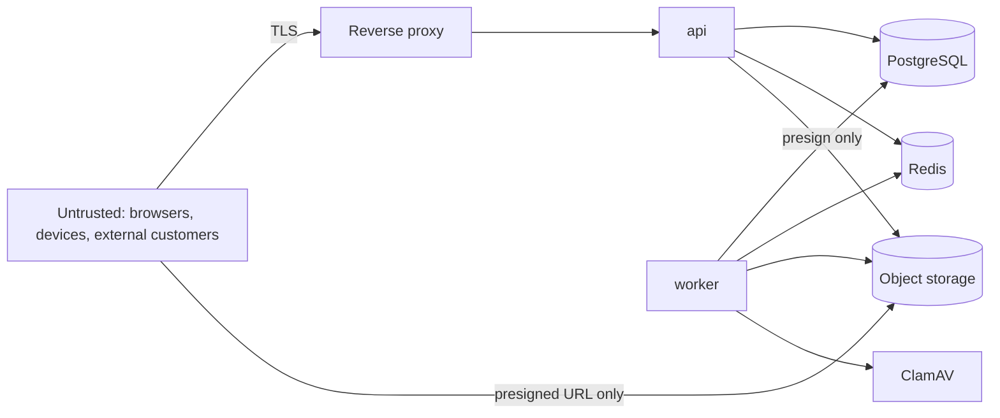

# Initial Threat Model (STRIDE)

## Assets

Message content and media · private contact data (email/phone) · credentials, refresh
tokens, MFA secrets · tenant directory (who works where) · audit log integrity ·
availability of emergency alerts.

## Trust boundaries

Boundaries: client ↔ API (all input untrusted) · tenant ↔ tenant (logical, same DB) ·
API ↔ storage (credentials server-side only) · admin ↔ platform (privileged, MFA).

## Threats and mitigations

| # | Threat (STRIDE) | Example | Mitigation | Status |
| --- | --- | --- | --- | --- |
| T1 | Spoofing | Credential stuffing / brute force on login | argon2id; per-IP+username Redis rate limit; account lockout with backoff; generic error messages; MFA for privileged roles | P2 |
| T2 | Spoofing | Stolen refresh token reused | Opaque hashed refresh tokens; rotation; reuse detection revokes the whole session; `HttpOnly; Secure; SameSite=Strict; Path=/api/v1/auth` cookie | P2 |
| T3 | Spoofing | Stolen access token | 15-min JWT bound to a server session checked on each request; revocation is immediate | P2 |
| T4 | Tampering / EoP | Client sends another tenant's `businessId` / `storeId` | Tenant always loaded from the DB row; scope coverage evaluator; cross-tenant integration tests | P2/P3 |
| T5 | EoP | Business Admin grants themselves platform role | `role.assign` cannot grant scopes wider than the assigner's; system roles flagged; tests | P2 |
| T6 | Info disclosure | Emergency contact phone/email leaks via API, socket, logs | Separate `UserContact` table; explicit public selects; payload tests; log redaction | P3/P5 |
| T7 | Info disclosure | Removed group member keeps receiving messages | Delivery re-resolves active members; user rooms only; access checks on history and media | P3 |
| T8 | Info disclosure | Group existence enumeration | Non-members get 404 (not 403) for conversations | P3 |
| T9 | Info disclosure | Directory scraping by employees/customers | `user.read` scope + store overlap; externals excluded; paginated & rate-limited search | P2/P3 |
| T10 | Tampering | XSS via message body or file names | React escaping; no `dangerouslySetInnerHTML`; strict CSP; attachments served with `Content-Disposition: attachment` and `nosniff` | P3/P4 |
| T11 | Tampering | Malicious upload (malware, polyglot, decompression bomb) | Allow-list; magic-byte verification; ClamAV INSTREAM (fail closed, AlertExceedsMax); 50 MP decode limit; quarantine prefix; audited | ✅ P4 |
| T12 | Info disclosure | Signed URL leakage | ≤ 5 min expiry; never in messages, socket events or logs; re-authorized per request; private bucket (anonymous GET → 403, tested) | ✅ P4 |
| T13 | DoS | Message flood / campaign abuse | Per-user and per-tenant rate limits; MFA-gated campaigns limited to one business; exact-count confirmation above 1,000 recipients; campaign-size quota; per-tenant dispatch rate and round-robin fairness; suppression and opt-out | P3/P6 ✅ |
| T21 | Spoofing / SSRF | Push subscription pointing at internal services | HTTPS only, allow-listed push-service hosts; tokens encrypted at rest and removed on sign-out | P8 ✅ |
| T22 | Info disclosure | Message content on lock screens | Default preview hides content; content only when the user opts in **and** the business allows it (tested by decrypting delivered pushes) | P8 ✅ |
| T14 | DoS | WebSocket connection storm | Connection caps per user/IP; handshake rate limit; payload size cap; backpressure | P3/P7 |
| T15 | Repudiation | Admin denies destructive action | Append-only audit log with actor, session, request id, IP | P2 |
| T16 | Info disclosure | Secrets in repo / logs | Env-only config validated at boot; `.env` git-ignored; pino redaction paths | P1 |
| T17 | EoP | SQL injection | Prisma parameterised queries; raw SQL only via tagged templates | P1 |
| T18 | CSRF | Cookie-authenticated refresh endpoint | SameSite=Strict + required `X-Storeline-CSRF: 1` header + Origin allowlist; all other endpoints use Bearer tokens | P2 |
| T19 | SSRF | Link previews (future) | Not implemented; when added: allowlisted egress proxy, block private ranges | — |
| T20 | DoS | Emergency alert not delivered because Redis is down | Incident and deadline persisted first; escalation is driven by a DB sweeper (no Redis timers), conditional and lock-protected; alerts re-shown from the DB on reconnect; per-recipient states show "sent" vs "delivered"; chain exhaustion audited + logged. Residual: in-app only until an SMS/push channel exists; monitoring alert pending (P7) | P5 ✅ |

## Residual risks (tracked)

- No end-to-end encryption: platform operators with DB access can read messages
  (ADR-0007). Mitigated by encryption at rest, least-privilege DB roles, and audit.
- Already-downloaded media cannot be revoked.
- Presence/last-seen can reveal working patterns; configurable per business.
